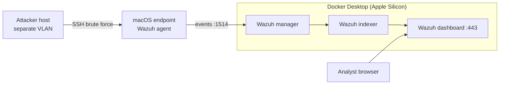

# Home SIEM Lab — Wazuh on Docker
 
A hands-on detection engineering lab: a self-hosted SIEM, a monitored endpoint, and real attacks against my own network to see what gets caught, what doesn't, and why.
 
I work in physical security systems engineering (video, access control, identity integrations across a global office footprint). This lab is where I build the cyber side of that skill set: log pipelines, detection rules, and incident triage.
 
---
 
## What this lab demonstrates
 
| Skill | How it's shown here |
|---|---|
| SIEM deployment | Full Wazuh stack (manager, indexer, dashboard) running in Docker |
| Endpoint monitoring | macOS agent enrolled and reporting to the manager |
| Threat detection | SSH brute force detected and correlated, mapped to MITRE ATT&CK T1110 |
| File integrity monitoring | File creation and modification detected, with content diffs |
| Detection engineering | Custom rule that escalates brute force from untrusted networks |
| Troubleshooting | Rule engine traced with `wazuh-logtest -v` to find a non-matching condition |
 
---
 
## Architecture
 

 
- **Host:** Mac Studio (Apple Silicon) running Docker Desktop
- **SIEM:** Wazuh 4.14.9, official single-node Docker stack
- **Endpoint:** the same Mac, running the native macOS ARM agent
- **Attacker:** a separate machine on a different VLAN, so attacks cross a network boundary
---
 
## Setup
 
### 1. Docker Desktop resources
Settings → Resources: at least **8 GB RAM**, 4 CPUs, 60 GB disk. The indexer won't stay up with less.
 
### 2. Deploy the stack
```bash
git clone https://github.com/wazuh/wazuh-docker.git -b v4.14.9
cd wazuh-docker/single-node
docker compose -f generate-indexer-certs.yml run --rm generator
docker compose up -d
docker compose ps
```
Dashboard: `https://<host-ip>` (self-signed cert). **Change the default credentials immediately.**
 
> **macOS gotcha:** the cert generator locked the output folder's permissions before copying the manager's root CA, failing with `Permission denied` on `root-ca-manager.pem`. Fix:
> ```bash
> cd config/wazuh_indexer_ssl_certs
> chmod u+w .
> cp root-ca.pem root-ca-manager.pem
> cp root-ca.key root-ca-manager.key
> chmod 400 root-ca-manager.*
> chmod u-w .
> ```
 
### 3. Enroll an agent
Dashboard → **Deploy new agent** → macOS (Apple silicon), server address = the host's LAN IP. Run the generated command, then:
```bash
sudo /Library/Ossec/bin/wazuh-control start
```
 
---
 
## Detections
 
### 1. SSH brute force
From the attacker machine, repeated failed logins against the endpoint:
```bash
ssh baduser@<endpoint-ip>   # wrong password, 8+ times within 2 minutes
```
 
**Result** (Threat Hunting → Events, `rule.id:(5710 OR 5760 OR 5712 OR 5763)`):
 
| Rule | Level | Meaning |
|---|---|---|
| 5760 | 5 | Single authentication failure |
| 5710 | 5 | Login attempt with a non-existent user |
| 5763 | 10 | **Correlation:** 8 failures from the same source IP within 120s |
 
Individual failures are noise; the correlation alert is the detection. Mapped to **MITRE ATT&CK T1110 (Brute Force)**.
 
### 2. File integrity monitoring
Default FIM scans every 12 hours, and on macOS `/etc` is a symlink to `/private/etc`, which isn't followed by default. Real-time FIM isn't supported on macOS. Configuration used for the lab:
 
```xml
<syscheck>
  <frequency>60</frequency>
  <directories check_all="yes" report_changes="yes">/Users/Shared/fim-test</directories>
</syscheck>
```
 
**Result:** rule **554** (file added) and rule **550** (checksum changed, with a diff of the content change).
 
**Lesson:** FIM detects differences from a baseline. Scans don't overlap, so on a large monitored set a change can take several minutes to appear. Restarting the agent forces a scan.
 
### 3. Custom rule — escalate untrusted brute force
Goal: raise brute force from outside trusted networks from level 10 to level 12 (which also crosses Wazuh's default email-alert threshold).
 
```xml
<group name="local,sshd,">
  <rule id="100100" level="12">
    <if_sid>5712,5763</if_sid>
    <srcip><UNTRUSTED_SUBNET>/24</srcip>
    <description>sshd: brute force from untrusted network ($(srcip))</description>
    <mitre>
      <id>T1110</id>
    </mitre>
  </rule>
</group>
```
 
Verified with `wazuh-logtest -v`:
```
Trying rule: 5763 - sshd: brute force trying to get access to the system.
*Rule 5763 matched
*Trying child rules
Trying rule: 100100 - sshd: brute force from untrusted network
*Rule 100100 matched
```
 
---
 
## Troubleshooting log
 
The most useful part of the lab was what didn't work the first time.
 
**Custom rule never fired.** The data looked right (`srcip` decoded, rule loaded), but the alert stayed at 5763.
 
1. **Checked decoding:** ran a real log line through `wazuh-logtest`. `srcip` was extracted correctly, even though newer macOS OpenSSH logs as `sshd-session` instead of `sshd`. Decoder ruled out.
2. **Checked rule loading:** found that edits need a manager restart before logtest or live traffic sees them.
3. **Tried a different approach:** rewrote the rule as its own frequency rule (`if_matched_sid 5760`). It lost to the built-in 5763: both are children of 5760, and the built-in rule matched first.
4. **Isolated the variable:** swapped the negated condition `<srcip>!<TRUSTED_SUBNET>/24</srcip>` for a positive match on the attacker's subnet. It fired immediately. **Root cause: the negated CIDR condition never matched.**
Other things learned along the way:
- Rule 5763 has a 60-second `ignore` window after firing; use a fresh logtest session for each test.
- `firedtimes` in logtest counts per rule, so it resets when a different rule takes over.
- Wazuh 4.x renamed the "Security Events" view to **Threat Hunting**.
